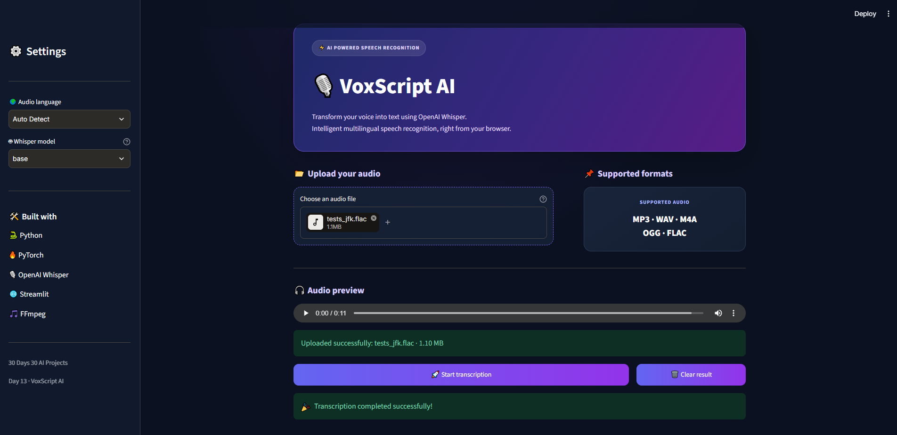
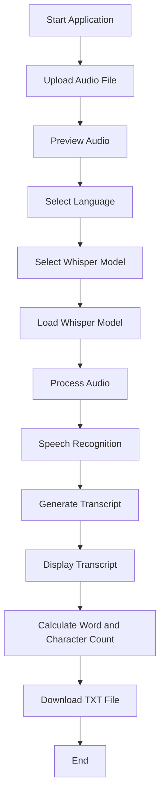

<div align="center">

# 🎙️ VoxScript AI

### AI-Powered Multilingual Speech-to-Text Application

Convert audio into text using OpenAI Whisper, Python, PyTorch, and Streamlit.

<p align="center">
  
</p>

<p align="center">
  
  
  
  
  
</p>

</div>

---

## 📌 About the Project

**VoxScript AI** is an AI-powered speech-to-text application that converts spoken audio into written text using OpenAI's Whisper automatic speech recognition model.

The application provides a simple and interactive interface built with Streamlit. Users can upload audio files, select a language, choose a Whisper model, and generate text transcriptions.

This project explores practical applications of Speech Recognition, Natural Language Processing, and Deep Learning.

## ✨ Features

- 🎙️ **Speech-to-Text:** Convert audio recordings into text.
- 🌍 **Multilingual Support:** Transcribe audio in multiple languages.
- 🤖 **Whisper Integration:** Uses OpenAI Whisper for speech recognition.
- ⚙️ **Model Selection:** Choose the available Whisper model.
- 🔊 **Audio Preview:** Listen to uploaded audio before transcription.
- 📝 **Transcript Display:** View and copy generated text.
- 📥 **Download Transcript:** Download the transcription as a TXT file.
- 📊 **Text Statistics:** View word and character counts.
- 🎨 **Interactive UI:** Dark-themed Streamlit dashboard.

## 🌐 Supported Languages

The application provides language selection for:

- Auto Detect
- English
- Tamil
- Hindi
- Telugu
- Malayalam
- Kannada
- French
- Spanish
- German
- Japanese
- Korean
- Arabic

*Transcription accuracy may vary depending on the language, audio quality, pronunciation, and selected Whisper model.*

## 🛠️ Technology Stack

| Technology | Purpose |
|---|---|
| Python | Core programming language |
| OpenAI Whisper | Speech recognition |
| PyTorch | Deep learning framework |
| Streamlit | Web application interface |
| FFmpeg | Audio processing |
| Git & GitHub | Version control and project hosting |

## 📸 Application Screenshots

### Dashboard

<p align="center">
   
</p>

### Transcription Result

<p align="center">
  
</p>

## 🧠 How It Works

VoxScript AI follows a simple speech recognition workflow:

1. User uploads an audio file.
2. The application loads the selected Whisper model.
3. FFmpeg handles the required audio processing.
4. Whisper analyzes the audio and recognizes spoken words.
5. The application displays the generated transcript.
6. Users can view text statistics and download the transcript.

## 🔄 Project Workflow



## 📂 Project Structure

```text
VoxScript-AI/
│
├── assets/
│   ├── voxscript-dashboard.png
│   └── Transcription result.png
│
├── outputs/
│
├── app.py
├── requirements.txt
├── README.md
└── .gitignore
```

## ⚙️ Installation and Setup

### 1. Clone the Repository

```bash
git clone https://github.com/21vicky/voxscript-dashboard.git
```

### 2. Navigate to the Project Folder

```bash
cd VoxScript-AI
```

### 3. Create a Virtual Environment

```bash
python -m venv venv
```

### 4. Activate the Virtual Environment

**Windows PowerShell:**

```powershell
.\venv\Scripts\Activate.ps1
```

### 5. Install Dependencies

```bash
pip install -r requirements.txt
```

### 6. Install FFmpeg

Download and install FFmpeg, then make sure it is available in your system PATH.

### 7. Run the Application

```bash
streamlit run app.py
```

The application will open in your browser.

## 📦 Requirements

The project dependencies are listed in `requirements.txt`.

```text
openai-whisper
streamlit
```

PyTorch and other required dependencies are installed as part of the Whisper installation.

## 🎯 Learning Outcomes

Through this project, I explored:

- Fundamentals of Automatic Speech Recognition (ASR).
- Working with OpenAI Whisper.
- Understanding multilingual speech recognition.
- Integrating PyTorch-based AI models.
- Audio processing using FFmpeg.
- Building interactive applications with Streamlit.
- Handling audio uploads and generated text.
- Creating downloadable transcription files.

## ⚠️ Limitations

- Transcription accuracy depends on audio quality and background noise.
- Processing time depends on audio duration and hardware.
- Different Whisper models offer different speed and accuracy trade-offs.
- Some languages may require larger models for better transcription accuracy.

## 🚀 Future Enhancements

- Add real-time microphone transcription.
- Support subtitle generation (SRT/VTT).
- Add speaker identification.
- Improve transcription accuracy for regional languages.
- Add translation of generated transcripts.
- Provide transcription history and export options.

## 👨‍💻 Developer

**Vignesh U**

Full Stack Developer | Python | AI & Data Analytics

<p align="left">
  <a href="https://github.com/21vicky">GitHub Profile</a>
</p>

---

<div align="center">

### 🚀 30 Days – 30 AI Projects

**Day 13 — VoxScript AI**

*Learning, Building, and Exploring Artificial Intelligence.*

</div>