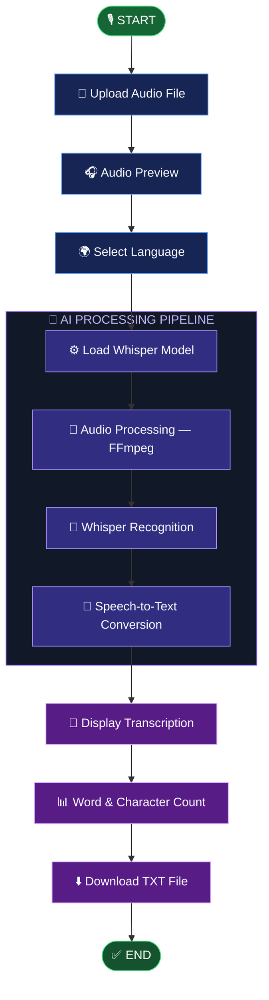

# 🎙️ VoxScript AI

### AI-Powered Multilingual Speech-to-Text Application

\<p align="center">   \ \</p>

\<p align="center">   \<b>Transform audio into text with the power of Artificial Intelligence.\</b>   \<br>   An intelligent speech recognition application powered by OpenAI Whisper. \</p>

\<p align="center">
&#x20; \
&#x20; \
&#x20; \
&#x20; \
&#x20; \
\</p>

---

## 📌 Overview

**VoxScript AI** is an AI-powered Automatic Speech Recognition (ASR) application built using **Python, OpenAI Whisper, PyTorch, and Streamlit**.

It converts audio recordings into text through advanced speech recognition technology, providing multilingual transcription and automatic language detection through Whisper.

The application offers a simple, interactive interface for uploading audio, previewing recordings, generating transcripts, and downloading recognized text.

## ✨ Key Features

| Feature                 | Description                                |
| ----------------------- | ------------------------------------------ |
| 🎙️ Audio Transcription | Convert speech recordings into text        |
| 🌍 Multilingual Support | Recognize speech in 12 languages           |
| 🔍 Language Detection   | Automatically identify the spoken language |
| 🎧 Audio Preview        | Listen to uploaded audio before processing |
| 🧠 AI Recognition       | Powered by OpenAI Whisper                  |
| 📝 Transcript Display   | View and copy recognized text              |
| 📊 Text Analytics       | Calculate word and character counts        |
| 📥 Transcript Export    | Download results as TXT files              |
| 🌙 Modern UI            | Interactive dark-themed dashboard          |

## 📸 Application Screenshots

### 🖥️ Dashboard

\<p align="center">   \ \</p>

### 📝 Transcription Results

\<p align="center">
&#x20; \
\</p>

## 🛠️ Technology Stack

| Technology     | Purpose                       |
| -------------- | ----------------------------- |
| Python         | Core application development  |
| OpenAI Whisper | Automatic speech recognition  |
| PyTorch        | Deep learning framework       |
| Streamlit      | Interactive web interface     |
| FFmpeg         | Audio decoding and processing |

## 🌍 Supported Languages

VoxScript AI supports speech recognition in the following languages:

- 🇬🇧 English
- 🇮🇳 Tamil
- 🇮🇳 Hindi
- 🇮🇳 Telugu
- 🇮🇳 Malayalam
- 🇮🇳 Kannada
- 🇫🇷 French
- 🇪🇸 Spanish
- 🇩🇪 German
- 🇯🇵 Japanese
- 🇰🇷 Korean
- 🌍 Arabic

**Language modes:** Automatic detection and manual language selection.

*Note: Transcription quality can vary depending on the language, audio quality, and selected Whisper model.*

## 🧠 AI Model Architecture

### OpenAI Whisper – Base Model

VoxScript AI uses the **Whisper Base model**, a multilingual automatic speech recognition model developed by OpenAI.

The model processes audio input and generates text transcriptions using learned speech representations.

**Processing pipeline:**

1. Audio file upload.
2. Audio preprocessing and decoding using FFmpeg.
3. Audio feature extraction.
4. Whisper-based speech recognition.
5. Text transcription generation.
6. Result display and downloadable output.

## 🔄 Project Workflow

The following diagram illustrates the complete processing pipeline, from audio upload to transcript export.



## 📂 Project Structure

```text
VoxScript-AI/
│
├── assets/
│   ├── voxscript-dashboard.png
│   └── Transcription result.png
│
├── outputs/
│
├── app.py
├── requirements.txt
├── README.md
└── .gitignore
```

## 🚀 Installation & Setup

Follow these steps to run VoxScript AI locally.

### 1. Clone the Repository

```bash
git clone https://github.com/21vicky/VoxScript-AI.git
```

### 2. Navigate to the Project Directory

```bash
cd VoxScript-AI
```

### 3. Create a Virtual Environment

```bash
python -m venv venv
```

### 4. Activate the Environment

**Windows:**

```bash
venv\Scripts\activate
```

**Linux / macOS:**

```bash
source venv/bin/activate
```

### 5. Install Dependencies

```bash
pip install -r requirements.txt
```

### 6. Install FFmpeg

Install FFmpeg and ensure that its executable is available in your system PATH.

### 7. Launch the Application

```bash
streamlit run app.py
```

Open the local Streamlit URL displayed in your terminal.

## 📦 Audio File Support

| Format                    | Extension |
| ------------------------- | --------- |
| MPEG Audio                | `.mp3`    |
| Wave Audio                | `.wav`    |
| MPEG-4 Audio              | `.m4a`    |
| OGG Audio                 | `.ogg`    |
| Free Lossless Audio Codec | `.flac`   |

**Maximum upload size:** 200 MB per file, as configured in the application.

## 📚 Learning Outcomes

Working on VoxScript AI helped me understand:

- Fundamentals of Automatic Speech Recognition (ASR).
- How AI models recognize and process human speech.
- Integrating OpenAI Whisper into Python applications.
- Audio decoding and processing using FFmpeg.
- Working with PyTorch-based deep learning models.
- Developing interactive applications using Streamlit.
- Handling audio uploads, transcription results, and file downloads.
- Implementing multilingual speech recognition.

## ⚠️ Limitations & Future Improvements

### Current Limitations

- Transcription accuracy depends on audio quality, background noise, and language.
- Tamil transcription accuracy with the Base model may require improvement.
- Processing speed depends on available CPU, RAM, and hardware resources.
- Very large audio files may require longer processing times.

### Future Enhancements

- Real-time microphone transcription.
- Subtitle generation (SRT/VTT).
- PDF and DOCX transcript exports.
- Speaker identification and diarization.
- Translation between supported languages.
- Improved transcription accuracy.
- GPU acceleration support.

## 👨‍💻 Developer

\<p align="center">
&#x20; \<b>Vignesh U\</b>
&#x20; \<br>
&#x20; \<a href="[https://github.com/21vicky](https://github.com/21vicky)">GitHub Profile\</a>
\</p>

## 📅 30 Days – 30 AI Projects

\<p align="center">
&#x20; \<b>Day 13 | VoxScript AI\</b>
&#x20; \<br>
&#x20; Turning Speech into Text with Artificial Intelligence. 🚀
\</p>

---

\<p align="center">
&#x20; ⭐ If you find this project interesting, consider giving it a star!
&#x20; \<br>\<br>
&#x20; \<b>Built with ❤️ using Python, Whisper & Streamlit.\</b>
\</p>
